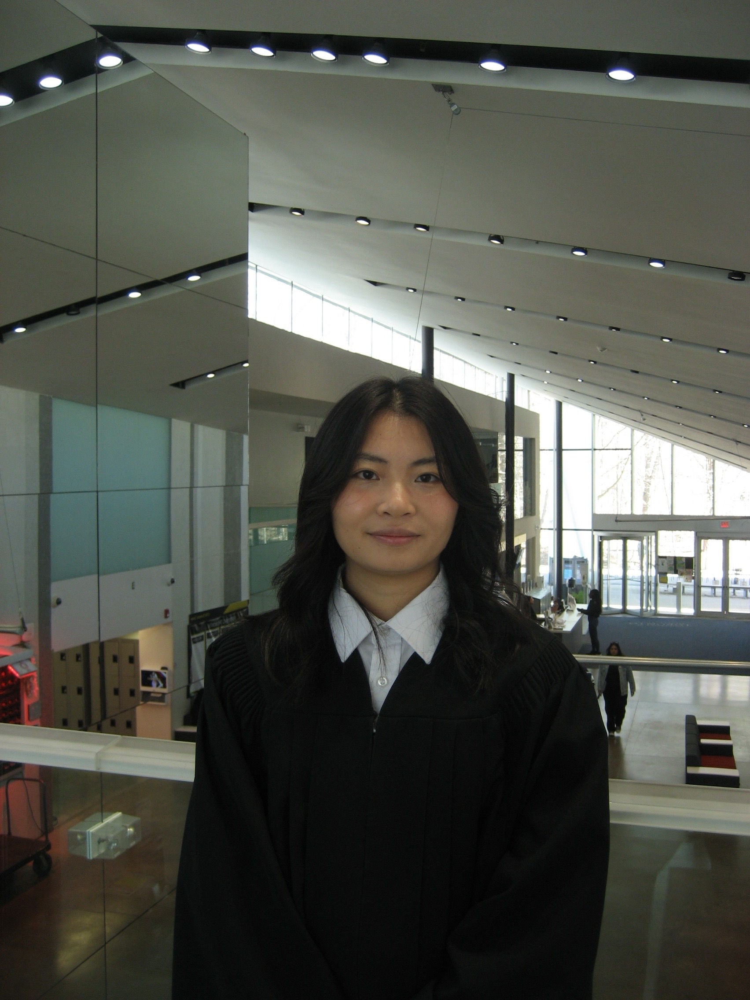

  
  

    I graduated from the University of Toronto, specializing in Computer Science with a minor in Biology. After working as a Product Engineer for a while, I am currently planting trees in Penticton, BC for the summer while navigating what I want next.
      
    In this fast-moving tech world, I want to document my journey as I work toward becoming a more reliable and thoughtful engineer — starting with my path to becoming a Rustacean.
      
    Some of my hobbies include backcountry camping, climbing in all forms (outdoor, indoor, boards), and playing ice hockey.
  

